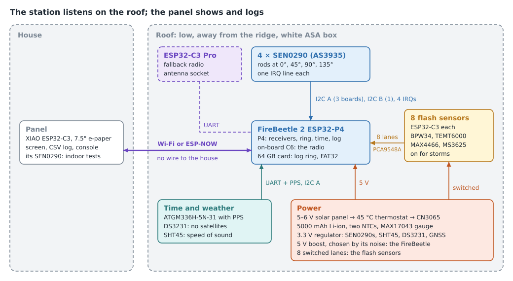
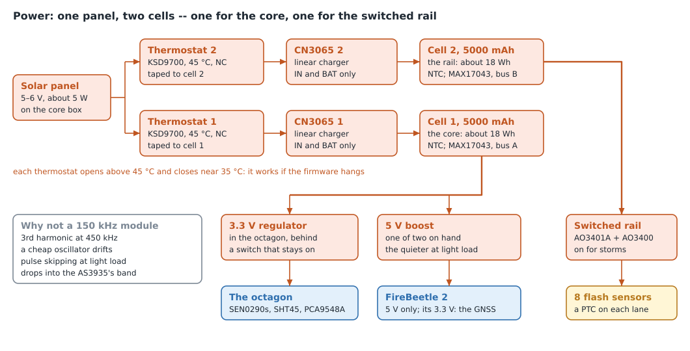
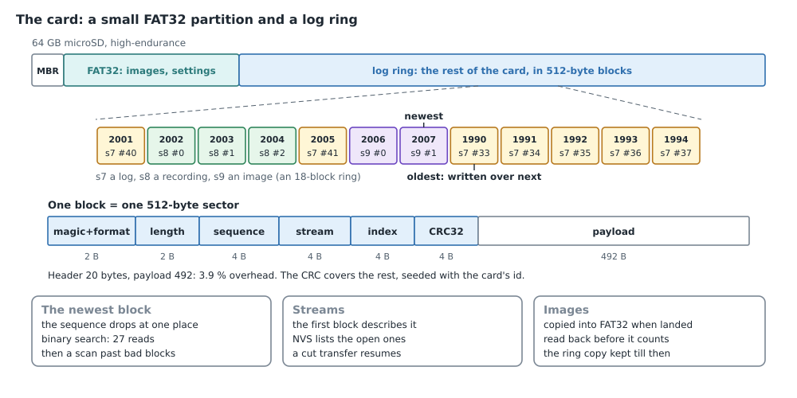
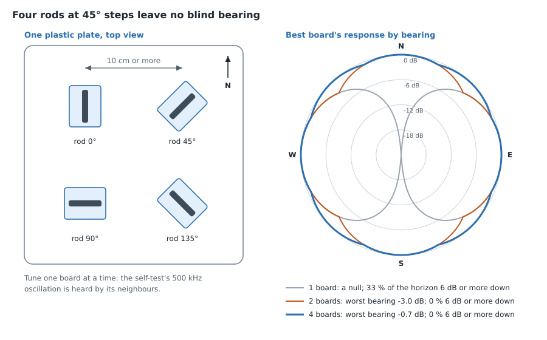
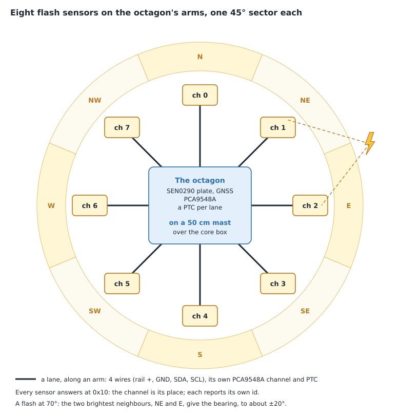
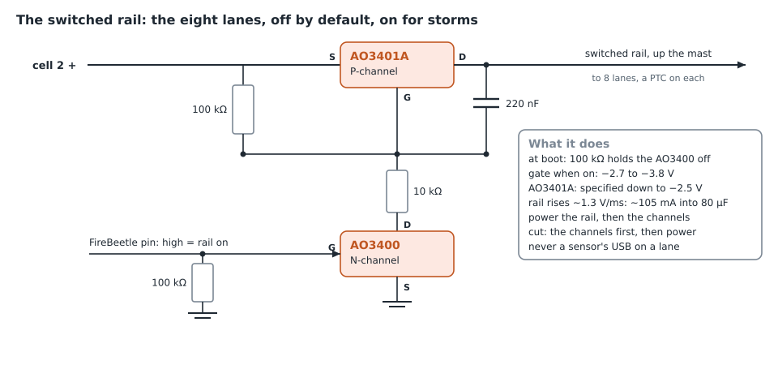
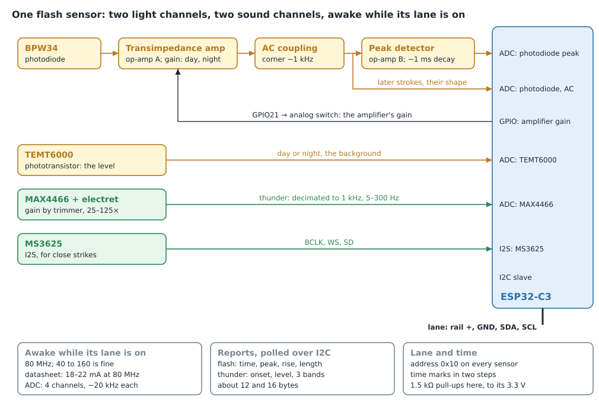
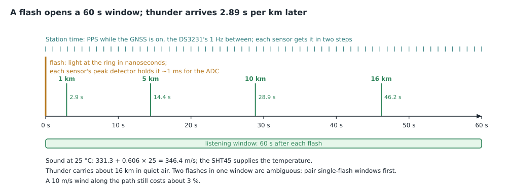

# Lightning station: architecture proposal

A proposal, 2026-11-02, revised the same day. Nothing here is built yet. The
pictures are generated by [`figures.py`](figures.py); run it after changing a
number they show.

## Why a station

Indoors the AS3935 hears almost nothing. In one storm the GOES-19 satellite's
Geostationary Lightning Mapper (GLM) counted hundreds of flashes within 10 km
of the house, and the panel logged none (firmware 0.21). In a later storm, on 0.22, it caught roughly one flash in
ten. Outside, on its own cell, the same board logged 13 strikes in 11 minutes.
The sensor and the firmware work; the room drowns most of what they should hear.

| Where the panel sat | Disturbers | Noise | Strikes logged |
| --- | --- | --- | --- |
| Indoors, on USB | 7.6–7.9 per s | ~0 per min | none in a nearby storm |
| Indoors, on its cell | 3.1 per s | ~48 per min | none |
| Outside, on its cell | not logged | not logged | 13 in 11 min |

USB power brings in more than half of the indoor flood; the room supplies the
rest. Powering the e-paper down changed nothing (7.8 against 7.8 per s). Two
lessons shape the station: it must sit outside, away from the house's
electronics, and it must not be powered from anything switching near 500 kHz.

Two cautions from the outdoor run. The panel's distance estimates read 6–14 km
for flashes GLM placed tens of kilometres away. And "overhead" readings matched
electrical events, such as a USB plug-in, as well as real close strikes.

## At a glance

Everything that listens moves onto the roof, on its own solar power, with no
wire to the house. The panel stays almost as it is, with new firmware: it keeps
the screen and the log, and talks to the station over Wi-Fi.

## Station core

A FireBeetle 2 ESP32-P4 (DFR1237) on an IO shield is the whole station's brain.
Its P4 runs the AS3935s, the eight flash sensors, GNSS and DS3231 time, and the
log on its card. Its on-board ESP32-C6, which comes with an antenna attached, is
the radio, with an ESP32-C3 Pro on UART as the fallback.

| FireBeetle 2 resource | Used for |
| --- | --- |
| I2C bus A at 200 kHz | 3 SEN0290s (0x01–0x03), SHT45 (0x44), MAX17043 (0x36), DS3231 (0x68) |
| I2C bus B at 200 kHz | the 4th SEN0290 (0x01); a PCA9548A switch (0x70), one channel per flash-sensor lane; a second MAX17043 (0x36) only if a second, separate cell is fitted |
| 4 GPIOs | one IRQ per SEN0290 |
| 8 GPIOs, or an expander | the lane switches, one per flash sensor |
| 1 GPIO | the PCA9548A's RESET |
| 1 GPIO | the GNSS's power switch |
| 1 GPIO | the DS3231's 1 Hz output, between GNSS fixes |
| SPI | optionally a fifth receiver: an AS3935 board with an MA5532-AE antenna |
| UART + 1 GPIO | the ATGM336H-5N-31: sentences and PPS |
| 2 GPIOs | the CN3065's CHRG and DONE: charging, full or no sun |
| 2 ADC inputs | the two NTCs on the cell |
| TF card | 64 GB: a FAT32 partition and the log ring |
| UART | only if the on-board C6 falls short: an ESP32-C3 Pro with its antenna socket as the radio, nothing more |

**The lane switches** can go through an expander if pins run short, but only one
whose pins power up as inputs without pull-ups (MCP23008 class). A PCF8574's
pins come up high, which would switch every lane on at once. Direct GPIOs need
the same care: a pin that pulls up at reset turns its lane on, so use pins that
come up floating, away from the strapping, JTAG, USB and UART0 pins.

**The PCA9548A's RESET** is pulled low through a resistor and driven high by the
firmware. Whenever the P4 resets, browns out or trips its watchdog, every
channel drops at the moment the lanes lose power, and no dead sensor is left on
bus B.

**The bus clock.** Both buses run at 200 kHz rather than 100 kHz, where SCL's
fifth harmonic falls on 500 kHz, the AS3935's own band. That moves the energy
rather than removing it: at 200 kHz SCL's harmonics sit at 400 and 600 kHz, and
SDA's data spreads energy around 500 kHz at either rate. So it is a hypothesis
to test: phase 4 measures the disturber rate with the ring polling against idle,
at 100 against 200 kHz.

**Time.** While the GNSS is on, the ATGM336H-5N-31's PPS disciplines the P4's
clock. To save power the GNSS runs a few minutes every six hours, through its
own switch. Between fixes the DS3231 (±2 ppm, approx.) keeps the second through
its 1 Hz output, and the date in its registers; it also covers indoor testing,
a power loss and a cold start. Each flash sensor gets station time in two steps
over its own lane: a "mark", which the FireBeetle timestamps in its
transaction-complete interrupt and the sensor in its receive interrupt, then
"that mark was at t". The sensor's handler sits in IRAM, so a flash write
cannot delay it. Several marks, keeping the one with the least delay, give tens
of microseconds (approx.), and re-marking every few seconds tracks the sensors'
crystals (±10 ppm is 10 µs a second). There is no sync wire, and no I2C general
call, which the SEN0290 on bus B would also hear.

**The power chain.**

A 5–6 V panel feeds a CN3065 and a 5000 mAh Li-ion cell (about 18 Wh), with the
MAX17043 across the cell, before anything converts its voltage:
- **A 3.3 V linear regulator** serves the SEN0290s, the SHT45, the DS3231 and the
  GNSS. Below about 3.4 V its rail follows the cell down (approx.: its dropout),
  which sets the station's floor, about 3.5 V (approx.): below it nothing is
  written to the card and the ring stays off.
- **A 5 V boost** serves the FireBeetle, which takes 5 V only.
- **Eight switches** serve the flash sensors' lanes, straight from the cell.

The CN3065 is linear, as on the moisture project's relays, so it adds no
switching noise. Three cautions around it:
- **The thermostat.** The module brings out no TEMP pin, so a 45 °C
  normally-closed bimetal thermostat (KSD9700 class) taped to the cell, in series
  with the solar input, stops charging when the cell is hot.
- **The panel's voltage.** A 6 V-class panel reaches about 7 V open-circuit on a
  cold, bright morning with the cell full, above the CN3065's absolute maximum
  of about 6.5 V (approx.; check the datasheet). Pick a panel whose cold
  open-circuit voltage stays under it, or clamp it.
- **CHRG and DONE** drive the module's LEDs from the panel's voltage. Lift the
  LEDs and pull the pins up to 3.3 V before they meet a P4 GPIO, which is not
  5 V tolerant.

**The boost is the switcher the design adds.**
- **Forced PWM.** It must be fixed-frequency at 1 MHz or more, with a
  forced-PWM mode, because many small boosts skip pulses at light load and drop
  into the AS3935's band. The MT3608 does exactly that at light load, so it is
  not the part.
- **Current.** DFRobot gives the FireBeetle's Wi-Fi peaks as 1050 mA at 5 V.
  Size the boost for 1.5 A at 5 V from a 3.0 V cell, with bulk capacitance at the
  FireBeetle's input.
- **Not a 150 kHz module:** its third harmonic sits at 450 kHz, a cheap
  oscillator drifts, and it skips pulses at light load.
- **The FireBeetle's own regulators.** It carries buck converters of its own (to
  3.3 V, and to the P4's core voltage), right beside the SEN0290 plate. Phase 0
  or 1 measures the FireBeetle alone, idling, next to one SEN0290.

| Load | From the cell (mA) | Duty | Energy (Wh/day) |
| --- | --- | --- | --- |
| FireBeetle 2 in deep sleep (DFRobot: 31.5 mA at 5 V) | ~50 | between storms | 4.4 |
| FireBeetle 2 awake, Wi-Fi off (DFRobot: 80 mA at 5 V) | ~125 | storm hours | 0.47 per hour |
| Wi-Fi reports (DFRobot: 80 mA average, 1050 mA peak, at 5 V) | | seconds per report | measure |
| 4 × SEN0290, power LEDs removed | 0.28 | 100 % | 0.02 |
| GNSS, a few minutes every 6 h, switched | ~25 | ~1 % | 0.01–0.02 |
| The SD card, idle, behind the FireBeetle's regulators | measure | 100 % | about 0.1 per mA |
| Flash-sensor ring, on during storms | 8 × 18–22 (datasheet, 80 MHz, chip only) | storm hours | 0.5–0.65 per hour |

The FireBeetle's rows price DFRobot's figures at 5 V through a boost of about
85 %.

A 5 W panel puts an estimated 17 Wh into the cell on a sunny day and about 1 Wh
on a dull one (approx.):
- **The 17 Wh** is about five sun-hours of the panel's current, at the cell's
  voltage, since a linear charger turns the rest into heat.
- **The CN3065 module's current-setting resistor** caps it, so read that before
  trusting the figure.
- **Nothing here has been measured:** no relay's daily energy has been either,
  so phase 2 measures this station's panel.

**The station's budget:**
- **Between storms** the base load is about 4.5–5 Wh a day, almost all of it the
  FireBeetle's deep sleep. Each dull day costs about 4 Wh, so the 18 Wh cell
  rides out about 4 of them, fewer counting the floor.
- **A storm hour** adds about 1.1 Wh: the FireBeetle awake plus the ring.
- **The FireBeetle cannot idle awake.** DFRobot's own figures rule it out: 80 mA
  at 5 V is about 11 Wh a day from the cell. It has to deep-sleep between storms
  and wake on an AS3935 interrupt.
- **Option B, the fallback core,** takes over if even deep sleep proves too
  much: an ESP32-C6-N16 board (nanoESP32-C6, ESP32-C6-WROOM-1, 30 pins, WROOM
  antenna). It is its own radio and idles far lower, but has no FPU and runs at
  160 MHz. That is enough for consolidating results, since the flash sensors do
  their own processing.

**The ring decides the rest.**
- **On only for storms,** it costs 0.5–0.65 Wh per storm hour.
- **On all day,** it would take 13–16 Wh, more than this panel and cell can
  carry.
- **A second cell in parallel** is the room to grow. Match the two cells'
  voltages before joining them, and give each its own fuse and its own NTC. Keep
  one CN3065 and one MAX17043, which then see a single 10 Ah cell.
- **Two separate cells** are the other way: cell 2 feeds the lanes and cell 1
  the core, each with its own CN3065 and its own MAX17043. The second gauge has
  the same fixed address, 0x36, so it goes on bus B.

**Power LEDs.** Each SEN0290 carries a red power LED drawing 1–2 mA (approx.),
and each C3 SuperMini one more; lift their resistors.

**The card.**

A 64 GB high-endurance microSD card (the kind sold for dashcams, rated to
85 °C), split in two by its partition table:

- **Partition 1, FAT32, a few GB:** firmware images for the station and the
  flash sensors, settings backups, exports. It is written rarely, and a PC reads
  it.
- **Partition 2, type 0xDA (non-file-system data):** the rest of the card, a raw
  log ring. The ring code finds its start and size in the partition table;
  FatFs mounts the first FAT volume it finds.

The ring is a sequence of 512-byte blocks, one sector each, so each block is one
write. Each starts with a 20-byte header, leaving 492 bytes of payload, a 3.9 %
overhead:

| Field | Bytes | Why |
| --- | --- | --- |
| magic + format | 2 | tells a ring block from a blank or stray sector; never 0x0000 or 0xFFFF, which is what blank cards read as |
| length | 2 | the payload's length, for a partly filled block |
| sequence | 4 | every block written, in order (a u32: 2 TiB of writes before it wraps) |
| stream | 4 | which stream the block belongs to |
| index | 4 | its place in that stream; a gap shows a lost block |
| CRC32 | 4 | over the rest of the sector, seeded with the card's own id |

- **Streams.** A daily strike log, a firmware image arriving, a thunder
  recording: each is a stream. Its first block describes it: name, kind, start
  time, expected size and checksum. That way the ring stands without NVS.
- **NVS lists the open streams.** The list is written when a stream opens or
  closes, never per block. An interrupted firmware transfer resumes at its next
  block after a reset. Losing NVS costs one slow rescan of the card (about
  55 minutes at 20 MB/s, approx.), not the data.
- **The CRC's seed** is the partition table's 4-byte disk signature, so blocks
  left by an earlier ring on the same card fail the check.
- **Finding the newest block.** The sequence drops at exactly one place in the
  ring, so a binary search finds the newest block in 27 reads, without NVS. A
  probe that lands on a damaged or blank block steps outward to the nearest
  valid one. After converging, the search scans forward past any run of bad
  blocks before trusting the head.
- **Writing.** Small records wait in RAM and go out as a partly filled block
  every few seconds. Images and recordings write many sectors in one command.
- **Wrapping.** The ring writes over its oldest block. A stream that loses its
  first blocks is cut short from the front: harmless for a log, fatal for an
  image.
  - So a landed image is copied into the FAT32 partition and read back with a
    matching checksum before the station reports it received.
  - Its copy in the ring is kept until then.
  - An aborted transfer never completes, and its blocks are simply written over
    in their turn.
- **Damage is found, not prevented.** Every block is checked, and readers skip
  one whose CRC fails rather than stopping. When the power drops mid-write, a
  cheap card can damage sectors wherever its own mapping put them, the FAT32
  partition included. The cell floor is the main defence: nothing is written
  below it.
- **Preparing a card.** The station prepares a card itself, but only when
  sector 0 holds no valid partition table, or on a console command. It writes
  the partition table, then formats partition 1 alone. It never uses ESP-IDF's
  `format_if_mount_failed` or `esp_vfs_fat_sdcard_format`: both make the whole
  card one FAT volume and erase the ring.

The block format, the newest-block search, damaged and blank probes, and a
previous ring's leftovers are all tested on a PC, with a file standing in for
the card, the way the moisture project's `backlog` crate tests its ring.

**Hardware.**

| Item | Status | Why |
| --- | --- | --- |
| FireBeetle 2 and IO shields, SEN0290s, ATGM336H, CN3065, the cell, MAX17043, C3s, TEMT6000s, DS3231, SHT45, MS3625s | on hand | the boards |
| 45 °C normally-closed bimetal thermostat (KSD9700 class) | on hand | the charge cut-off the CN3065 module cannot give |
| Two 10 kΩ NTCs | on hand | the cell's temperature on both sides, logged |
| A radiation shield for the SHT45 | on hand | air temperature for the speed of sound, humidity, weather in the log |
| Cable glands, a breathing vent, desiccant, 1 mm stainless mesh | on hand | the white ASA box against rain, condensation and animals |
| Acoustic membranes and fur windscreens | on hand | the microphones in rain and wind |
| PCA9548A, AO3401A and AO3400 | on hand | a channel and a power switch for each lane, and the GNSS's switch |
| MAX4466 modules and 6050 electret capsules (−52 dB) | ordered | compare a 6050 against the module's own capsule with a slow low sweep; turn the gain up for distant thunder |
| 5 V boost: forced PWM, 1 MHz or more, 1.5 A at 5 V from a 3.0 V cell | to choose | the FireBeetle takes 5 V only; no pulse skipping into the AS3935's band |
| 64 GB high-endurance microSD | check stock | the log ring and the FAT32 partition |
| Eight BPW34 photodiodes (Vishay's BPW34 and BPW34S differ only in packing) | check stock | the fast light channel |
| Eight dual rail-to-rail op-amps (MCP6002 or TLV9002 class) | check stock | each photodiode's amplifier and peak detector |
| Eight low-capacitance analog switches (74LVC1G66 or TS5A3166 class) | check stock | each amplifier's day and night gain |
| Eight PTC fuses, about 200 mA hold | check stock | one per lane |
| TVS arrays, 4 lines each (SRV05-4 class), one per lane, and more for the IRQ and power lines | check stock | where the cables enter the box |

## AS3935 receivers

Four SEN0290s with their antenna rods pointing 0°, 45°, 90° and 135° leave no
blind direction: the worst bearing is only 0.7 dB down. 0° and 180° are the same
rod, so four boards at 90° steps would double up.

Each board's antenna is a small ferrite rod. A distant strike's magnetic field is
horizontal and square to its bearing, and the rod reads only the part along its
axis. So a rod pointing straight at a strike hears almost nothing: its null. The
table and the curves above are computed geometry, not a measurement.

| Boards | Rod directions | Worst bearing (dB) | Horizon 6 dB or more down |
| --- | --- | --- | --- |
| 1 | 0° | null | 33 % |
| 2 | 0°, 90° | −3.0 | 0 % |
| 4 | 0°, 45°, 90°, 135° | −0.7 | 0 % |

**Reporting and voting.** A strike is logged when any board reports it. It is
marked confirmed when two or more agree within a few milliseconds. A USB plug-in
or a neighbour's hammer reaches all four at once, so votes catch only local
faults; they do not replace the satellite check.

**They arm the ring.** Any board's strike switches the flash sensors on (below),
and wakes the FireBeetle. The boards hear storms out to about 40 km: they miss
single flashes, not whole storms.

**Different tuning, one way.** Three boards run the panel's noise-floor tuner;
the fourth stays fully open as a permanent sensitive ear. That replaces the
panel's periodic dip, in which the tuner briefly lowers its defences to listen
for lightning ([console.md](../console.md)).

**A bearing, maybe.** The four boards' energy readings follow the field's
direction, like a classic magnetic direction finder, giving a bearing modulo 180°
that the flash sensors can settle. The datasheet gives the energy no physical
unit, so this is an experiment: compare it with GLM.

**They cannot triangulate.** Boards 10 cm apart see one field, and each distance
is a statistical estimate in 15 bins up to 40 km, which read 6–14 km for flashes
GLM placed tens of kilometres away.

**Mounting and tuning.** The four boards lie flat on one plastic plate, at least
10 cm apart. The self-test sets one antenna oscillating at 500 kHz, which its
neighbours hear, so tune one board at a time, then clear every board's
statistics. Each board has its own IRQ line.

**Spares.** The AS3935 board with the MA5532-AE antenna can be a fifth receiver
on SPI if four prove short. The panel's own SEN0290 stays for indoor testing.

**Carries over from the panel:** the driver, the antenna self-test, the
noise-floor tuner, the golden record (the settings that last heard lightning,
see [console.md](../console.md)) and the rule that "overhead" teaches nothing.
New: finding every board on two buses, a tuning-capacitor search per board, and
combining four reports into one.

## Flash sensors

Eight identical flash sensors sit around the FireBeetle, each facing its own 45°
sector, each on its own 4-wire lane: the cell's positive, GND, SDA and SCL. A
star rather than a chain, so a broken or wet cable costs one sensor, not every
sensor after it. Each is an ESP32-C3 (SuperMini or C3 Pro) with two light
channels, a BPW34 photodiode and a TEMT6000, and two sound channels, a MAX4466
electret and an MS3625. It does its own processing; the FireBeetle collects
results, never raw signals.

**On for storms.**
- **Switching on.** When any SEN0290 reports a strike, the FireBeetle switches
  all eight lanes on. The sensors boot in well under a second (approx.) and stay
  awake, sampling, at 80 MHz; anything from 40 to 160 MHz will do.
- **Switching off.** After an hour without a strike the lanes go off, and a
  switched-off lane draws nothing.
- **The cell comes first.** Arming is refused below the floor.
- **The log shows what it costs.** It records each arming and the ring's hours
  a day. A board that reports false strikes more often than hourly (the fully
  open fourth is the likeliest) would keep the ring on, and that would show
  there.
- **What it loses** is the light of the first flash of a storm that forms
  overhead. That flash's thunder still arrives seconds later, after the sensors
  are up.
- **The console setting.** `ring storm` is the default. `ring on` keeps the ring
  on all the time, for testing or a bigger supply, and `ring off` silences it.

**Why awake, and why a C3.**
- **Why awake.** A sleeping C3 wakes only on a digital edge. A sensor that slept
  would need a comparator to turn a flash into one; an LMV331IDBVR (SOT-23-5) is
  the one to keep in the drawer. Awake, it needs none.
- **Why not a C6.** Its low-power core cannot read the ADC:
  - ESP-IDF has no API for it, and its sleep code powers the ADC off.
  - An Espressif engineer put it plainly: "C6 do not have an ADC in the LP/RTC
    domain that can be used during sleep".
  - Of the chips with such a core, only the P4's can.
  - Awake, a C6 costs as much as a C3 or more by their datasheets: idle at
    80 MHz with the peripherals clocked, 25 mA against 18.

**One PCA9548A channel per lane.**
- **Isolation.** A stuck sensor or a wet lane is switched off alone, and each
  lane's capacitance counts on its own.
- **One address.** Every sensor answers at 0x10, which must stay clear of
  everything else on bus B: 0x01, 0x36 and 0x70. All eight carry the same image,
  and the channel is a sensor's place.
- **Each sensor's own id.** Each reports its id (its eFuse MAC). The FireBeetle
  keys its calibration by that id and reports a swap, so a spare never
  inherits another unit's constants.
- **Pull-ups.** The lane's SDA and SCL pull-ups, 1.5 kΩ, sit on the sensor, to
  its own 3.3 V. At 200 kHz the limit is the 300 ns rise time, about 230 pF with
  1.5 kΩ (approx.), so measure a lane's edge in phase 4.

**A switch per lane.** An AO3401A on the high side, driven by an AO3400, with a
PTC fuse after it:
- **Not the AO3401A alone:** its source sits on the cell at up to 4.2 V, so a
  3.3 V pin at its gate leaves −0.9 V, inside its −0.5 to −1.3 V threshold, and
  "off" may still be half on.
- **Not the AO3400 alone, switching the ground side:** the sensor's ground would
  float while SDA and SCL stay connected, and it would power itself through the
  bus.
- **Off by default.** Lanes come up one at a time, as follows:
  1. The firmware writes "lane k going on" to NVS, then powers the lane.
  2. It selects the lane's PCA9548A channel.
  3. It clears the note once the sensor answers.
  4. If the lane shorts and browns the station out, the next boot finds the
     note and leaves lane k off.
- **A wet lane** leaking tens of milliamps causes no brownout, which is what the
  PTC (about 200 mA hold) is for.
- **A soft start.** 47 nF from gate to drain slows the lane's rise to a few
  volts per millisecond (approx.), so the sensor's capacitors charge at tens of
  milliamps. Check the cell rail on a scope as a lane switches on: the aim is no
  dip.
- **Cutting a lane:** its channel first, then its power. A P4 reset does both at
  once, through the PCA9548A's RESET.
- **Never plug a sensor's USB in while it is on a lane.** The SuperMini's 5 V
  pin is its USB supply, and the AO3401A's body diode would carry that into the
  station's cell.
- **A sensor that stops answering** is power-cycled through its switch; no trip
  to the roof.
- **Each sensor board's regulator.** The SuperMini's ME6211 runs the C3 to a
  cell of about 3.4 V (approx.). A board with an AMS1117-class regulator, about
  1 V of dropout, would not run from a Li-ion cell at all, so check the C3 Pros
  before choosing which boards go on the ring.

| Sensor pin (ESP32-C3) | Function |
| --- | --- |
| GPIO0, ADC1 | the photodiode's peak detector: each stroke, held about 1 ms |
| GPIO1, ADC1 | the photodiode, AC-coupled: later strokes and their shape |
| GPIO3, ADC1 | TEMT6000: the light level, day or night |
| GPIO4, ADC1 | MAX4466: thunder |
| GPIO5, GPIO6 | I2C slave on its lane |
| GPIO7, GPIO10, GPIO20 | I2S from the MS3625: BCLK, WS, SD |
| GPIO21 | the photodiode amplifier's gain, through an analog switch |
| GPIO2, GPIO8, GPIO9 | left alone: strapping pins (GPIO8 is the LED, GPIO9 BOOT) |
| USB | first programming on the bench, off the lane |

**The ADC** samples its four channels at about 20 kHz each, 80 of the 83 kS/s
ESP-IDF allows. The pattern can repeat the photodiode channels if they need
more. The MAX4466's channel is decimated to 1 kHz on the sensor.

**The light channels.**
- **The BPW34 is the fast one,** 100 ns rise, but about 7 times less sensitive
  than the TEMT6000 by their datasheets (75 µA at 1000 lx against about 50 µA at
  100 lx). So it gets an amplifier: one dual op-amp, half a transimpedance
  amplifier and half an active peak detector, which has no diode drop to lose a
  weak flash in.
- **Day and night gain.** The firmware switches the amplifier's gain between
  day and night from the TEMT6000's level. It does so through a low-capacitance
  analog switch, not a power MOSFET, whose few hundred picofarads would short
  the night gain at the very frequencies a stroke occupies.
- **AC coupling** between the two halves, with its corner near 1 kHz, passes a
  stroke's sub-millisecond pulse. It cuts the 120 Hz flicker of mains-powered
  lights about 8 times, and the firmware also ignores a trigger that repeats at
  120 Hz.
- **The peak detector holds each stroke about 1 ms,** so the ADC never falls
  between the samples of a 50 µs stroke.
- **The TEMT6000 is the eye-like one:** the background level, day or night, and
  a second opinion. Its stock 10 kΩ load saturates near 660 lx; lower it for
  daylight.
- **Not UV.** The GUVA-S12SD covers 240–370 nm, where sunlight is full of UVA,
  so it gains nothing in daytime. UV also scatters about 35 times more than
  near-IR ((850/350)⁴), so a distant flash's UV arrives smeared, and its
  photocurrent is in nanoamps. It could still sit on the station as a UV-index
  weather channel.
- **Daytime, later.** Lightning's strongest line is oxygen at 777.4 nm, the one
  GLM watches through a 1 nm filter, and the BPW34 sees it. A 780 nm bandpass
  filter, about 10 nm wide, in front of the photodiode is the daytime upgrade;
  the BPW34F, with visible light blocked, is a smaller step.

**Direction from brightness.** Light crosses the ring in a nanosecond, so
direction comes from comparing peaks: the two brightest neighbours give the
angle. Cloud-lit flashes are not point sources, so expect about ±20°. Calibrate
every sensor once with a strobe at known bearings: TEMT6000 units vary up to
4.6 : 1. A return stroke 10 km away adds only about 0.1–1 % to full sun
(approx.), so expect most direction fixes at night or under heavy cloud.

**Results over I2C.** The FireBeetle polls each sensor, one channel at a time,
every 100–200 ms. A flash report carries its station time, peak, rise time and
duration (about 12 bytes); a thunder report its onset time, level and energy in
three bands (about 16 bytes). Eight sensors' reports are a few hundred bytes a
second at most, easy at 200 kHz.

**Firmware updates over I2C.** Each sensor takes a new image into its second OTA
slot, with ESP-IDF's own checks and rollback; the FireBeetle keeps the image in
the card's FAT32 partition and updates one sensor at a time. The sensors' Wi-Fi
stays off: each transmit would be a current burst beside the SEN0290s.

There are 8 C3 SuperMinis and about 10 C3 Pros on hand: eight sensors and
spares.

## Sound

Each flash sensor's microphones give the distance: thunder arrives about 2.9 s
per km after the flash it saw. The compact ring gives distance only; a bearing
by sound would need sensors metres apart.

**Distance.** Sound travels at 331.3 + 0.606 · T m/s, and the SHT45 supplies T,
so temperature costs nothing; a 10 m/s wind along the path still costs 3 %. The
onset dates the nearest part of a kilometres-long channel, not the ground
strike. Thunder carries about 16 km in quiet air, so each flash opens a 60 s
listening window. Pair single-flash windows first: two flashes in one window are
ambiguous.

**Two microphones on every sensor.**

| Microphone | Low end | Level | Role |
| --- | --- | --- | --- |
| MAX4466 module, electret, on ADC | ~20 Hz as built; lower with a larger input capacitor | gain fixed by its trimmer, 25–125× | distant thunder |
| MS3625 (INMP441 class), I2S | −3 dB at 60 Hz | 24-bit, 61 dBA SNR | close strikes that would clip the electret |
| MAX9814 module (not used) | ~20 Hz | automatic gain under a 40, 50 or 60 dB ceiling | onset timing only: the AGC distorts levels and band energies |

The MAX4466 reaches lower than the MS3625, where thunder's rumble lives. Its
weakness is range: thunder spans roughly 60 dB, from a distant rumble to a close
crack, and a 12-bit ADC at fixed gain covers about as much. So its trimmer is set
for distant thunder, and the MS3625 catches the close ones it would clip. When
the modules arrive, measure them as built before swapping capsules: the
20 Hz–20 kHz on the label is a marketing range, and the input capacitor sets the
real low end.

**Processing on the sensor.** The MAX4466's channel, decimated to 1 kHz, is
band-passed 5–300 Hz; the MS3625 runs at 16 kHz, decimated to 1 kHz. Track the
onset against the noise floor and report its time, level and energy in three
bands (5–30, 30–120, 120–300 Hz).

**Thunder recordings.** Each sensor keeps the last 60 s of MAX4466 samples at
1 kHz, about 120 KB, in RAM. After the window closes, the FireBeetle pulls it
over the lane and files it in the card's log ring, to tune the onset detector on
real thunder later. Only for some windows, isolated flashes first: all eight
sensors recording all the time would be about 16 KB/s, and I2C at 200 kHz
carries roughly 20 KB/s in all.

**On the roof.**

- Rain on the roof and wind are the main noise: foam plus a fur windscreen on
  every microphone, behind an IP-rated acoustic membrane.
- A roof A/C condenser or nearby traffic sits in thunder's band: measure the
  noise floor in rain at night before trusting distances.
- A MAX4466 module draws well under 1 mA.

## Link and remote care

The FireBeetle's own C6 is tried first, from Rust on ESP-IDF through ESP-Hosted
and the wifi-remote component. Earlier attempts at it were under MicroPython,
and failed; Rust has not been tried. Check early whether ESP-NOW passes through
ESP-Hosted, or only Wi-Fi. The fallback is an ESP32-C3 Pro, with its antenna
socket, as the radio and nothing more, on a UART to the FireBeetle. Either radio
carries ESP-NOW through the moisture project's `link` crate, which already runs
on that project's relays, or Wi-Fi.

The moisture project's relays reach that project's own panel, in the same
house, from the ground. That suggests the roof is within range, but the link
from the roof to this panel is unmeasured until phase 0.

| Link | Roof to panel | Verdict |
| --- | --- | --- |
| The FireBeetle's own C6, from Rust through ESP-Hosted | unmeasured: phase 0 | tried first |
| ESP32-C3 Pro on UART, ESP-NOW or Wi-Fi, its antenna socket; with option B, the C6-N16's own radio | unmeasured: phase 0 | the fallback, if the on-board C6 falls short |
| SX1262 LoRa at 915 MHz, HC-12 | easy | not needed |

**Traffic.** The first strike of a storm goes at once, then one summary a
minute. Whatever the panel does not acknowledge waits in the card's log ring and
goes later: the panel resets on every USB unplug. Firmware images and logs move
over Wi-Fi in seconds; updates still wait for a storm-free day.

**Remote care.**

- **Two app slots with rollback.** A new image confirms itself only after these
  three checks:
  - every device that answered under the previous image answers again. That list
    is kept in NVS, and the lanes are powered one at a time for the check.
  - the panel acknowledges a report.
  - the loop has run 5 minutes under the watchdog.
- **Safe mode** after three failed boots in a row: sensors off, radio and
  console on, waiting for an image.
- **The console over Wi-Fi.** The station runs the panel's command table; its
  lines appear on the panel as `station: …`, and `station <command>` sends one.
- **Every setting in NVS**, each with a command, so tuning never needs an image.
  Flash-sensor images ride along and go out over I2C.
- **Lanes.** A sensor that stops answering is power-cycled through its switch. A
  lane that browned the station out stays off after the next boot, and the
  station says so.
- **Its own transmits.** Mark any AS3935 interrupt within about 10 ms of a Wi-Fi
  transmit as `own`. Measure first: one report a second for 10 minutes against a
  quiet baseline.

**The roof.**

- **Lightning.** The station must not be the highest point: keep it low, away
  from the ridge. Solar plus radio means no wire into the house, the main
  protection. TVS diodes where cables enter the box. A direct hit costs the
  station.
- **Plastic near the antennas.** Aluminium's skin depth at 500 kHz is 0.12 mm: a
  metal box blinds the SEN0290s.
- **Heat.** The white ASA box resists sun and UV, but a roof surface in summer
  sun reaches 60–70 °C (approx.).
  - Shade the Li-ion cell under the solar panel and give it airflow.
  - The bimetal thermostat on the cell breaks the solar input above 45 °C and
    closes again near 35 °C. It is passive, so it works even if the firmware
    hangs.
  - The two 10 kΩ NTCs, one on each side of the cell, go to FireBeetle ADC
    inputs for logging and a firmware alarm.
  - The MCU's die temperature runs hotter and lags, so it serves for logging
    only.
  - Discharge is fine to 60 °C. LiFePO4 copes better, for a later version.
- **Water and animals.** IP66 box, cable glands, drip loops, a breathing vent,
  desiccant; 1 mm stainless mesh over every opening against ants, wasps, frogs
  and lizards. A spider web over a TEMT6000 triggers it at night.
- **Storm winds.** Through-bolt everything, or plan to take it down before a
  big storm.
- **Dawn boot loops.** A flat cell recovers at first light, the radio start
  pulls it down, and it browns out again. Reuse the moisture project's relay
  power modes: below a floor, radios off and an hourly look at the cell. Reuse
  its `restart` crate too.

## Validation and phases

Every phase from 1 on ends with one storm checked against GLM, and its
measurement unlocks the next. A daily satellite cross-check already runs: GLM
flashes within 10, 20 and 40 km of home against the board's log, to the second.
GLM pixels are about 8–10 km across (approx.), so distances under 10 km need a
ground network such as Blitzortung, or ears with times noted.

| Phase | What it adds | Acceptance (proposed) |
| --- | --- | --- |
| 0. Roof survey | a C3 with one SEN0290 on a cell at the roof spot for 30 minutes; Wi-Fi from the roof spot to the panel | under 0.1 disturbers a second, 30 times under the 3.1 measured indoors on the cell; the link delivers every frame |
| 1. Does it hear outside | the FireBeetle 2 with one SEN0290, the DS3231, the card and the cell; reports over Wi-Fi; the FireBeetle alone beside one SEN0290, idling | one storm with at least 50 GLM flashes within 20 km: at least 50 % detected (indoors: a tenth at best), unmatched strikes at most 20 % of detections |
| 2. Self-powered on the roof | solar panel, CN3065, MAX17043, 5 V boost, SHT45, ATGM336H; deep sleep between storms; two OTA slots with rollback, safe mode, the console over Wi-Fi; the log ring | no rise in disturbers with the boost running; a Wi-Fi connect at a 3.3 V cell without a brownout; net charge at least zero over 7 days with 2 dull ones; cell under 45 °C while charging; 14 days without an unplanned reset; an image that never confirms rolls back; 20 power cuts while writing: no undetected corruption |
| 3. Four receivers | three more SEN0290s, rods at 45° steps | misses spread evenly across bearings; the energy-ratio bearing's error against GLM reported |
| 4. One flash sensor | a C3 with a BPW34 and its op-amp, a TEMT6000, a MAX4466 and an MS3625 on one switched lane; time marks; OTA over I2C; storm arming | time-mark error measured; at night at least 50 % of GLM flashes within 20 km seen by light, under 1 false trigger an hour; thunder onsets for at least 50 % of strikes under 10 km; the lane up within a second of a strike; the disturber rate with the ring polling against idle, and at 100 against 200 kHz; a lane's rise time on a scope |
| 5. Full ring | the other seven sensors, calibrated with a strobe | night bearings within ±20° of GLM |

**The season.** The proposal was written as the lightning season ended, so the
storm checks wait for the next one. What needs no storm fits the dry months
before it:
- the roof survey (phase 0 measures disturbers and the link, not strikes);
- the FireBeetle's deep-sleep and idle current against DFRobot's 31.5 and 80 mA,
  and the SD card's;
- a C3's current at 40, 80 and 160 MHz with four ADC channels and I2S running;
- ESP-NOW through ESP-Hosted;
- the boost's noise against one SEN0290;
- the MAX4466 against the 6050 capsules;
- the log ring, on a PC and then on a card with the power pulled mid-write;
- one flash sensor on the bench: its peak detector against a camera flash, its
  time-mark error, a lane switching on with the cell rail on a scope, and an
  update over I2C.

## Open questions

- [ ] **The FireBeetle's sleep.** Can it deep-sleep between storms at about
  DFRobot's 31.5 mA (at 5 V), and wake on an AS3935 interrupt quickly enough to
  read the strike? If not, option B.
- [ ] **No boost?** Could the cell feed the FireBeetle's 5 V input directly,
  with its own buck running flat out from 3.0–4.2 V? Then the boost would go.
- [ ] **A C3 awake.** The datasheet gives only 160 and 80 MHz, chip only:
  18–22 mA at 80 MHz with the peripherals clocked. What does a SuperMini draw at
  40 and 80 MHz with the ADC and I2S running?
- [ ] **Storm arming.** Does the first SEN0290 strike come early enough? Compare
  the arming times with GLM's first flash within 20 km.
- [ ] **The SD card.** Its idle current. The FireBeetle's schematic appears to
  switch the card's supply; check that its data-line pull-ups go off with it.
- [ ] **The C3 Pros' regulator.** Do they run from a Li-ion cell?
- [ ] **The roof spot.** Low and away from the ridge; shade for the cell; how far
  from the A/C condenser and the panel?
- [ ] **The radio.** ESP-NOW, as the relays use, or Wi-Fi for the link?
- [ ] **Strobe calibration.** Calibrate the ring once at known bearings, on a
  turntable or across the yard?
- [ ] **Daytime direction.** Is the gain switch enough, or is a 780 nm filter
  worth adding?

## Sources

Figures marked "(approx.)" are from memory or estimates, not from these pages.
The storm figures come from NOAA's GOES-19 GLM data (public bucket
`noaa-goes19`, product GLM-L2-LCFA) and the panel's own logs.

- [AS3935 Franklin Lightning Sensor IC datasheet (ams)](https://cdn.sparkfun.com/assets/learn_tutorials/9/2/1/AS3935_Datasheet_EN_v2.pdf)
- [Gravity: Lightning Sensor SEN0290 (DFRobot wiki)](https://wiki.dfrobot.com/Gravity:%20Lightning%20Sensor%20SKU:%20SEN0290)
- [FireBeetle 2 ESP32-P4 (DFRobot)](https://www.dfrobot.com/product-2950.html)
- [FireBeetle 2 ESP32-P4: specifications and current figures (DFRobot wiki)](https://wiki.dfrobot.com/dfr1237/)
- [ESP32-P4 Series Datasheet](https://documentation.espressif.com/esp32-p4_datasheet_en.pdf)
- [ESP32-C3 Series Datasheet](https://documentation.espressif.com/esp32-c3_datasheet_en.pdf)
- [ESP32-C6 Series Datasheet](https://documentation.espressif.com/esp32-c6_datasheet_en.pdf)
- [ESP-IDF ULP LP-Core Coprocessor, ESP32-C6](https://docs.espressif.com/projects/esp-idf/en/latest/esp32c6/api-reference/system/ulp-lp-core.html)
- [ESP-IDF issue 13422: no ADC in the C6's LP domain](https://github.com/espressif/esp-idf/issues/13422)
- [ESP-IDF Over The Air Updates, ESP32-C6](https://docs.espressif.com/projects/esp-idf/en/stable/esp32c6/api-reference/system/ota.html)
- [ESP-IDF ESP-NOW, ESP32-C6](https://docs.espressif.com/projects/esp-idf/en/stable/esp32c6/api-reference/network/esp_now.html)
- [ESP-IDF I2S, ESP32-C6](https://docs.espressif.com/projects/esp-idf/en/stable/esp32c6/api-reference/peripherals/i2s.html)
- [ATGM336H-5N User Manual](https://w2.electrodragon.com/Chip-cn-dat/ZHONGKEWEI-dat/ATGM336H-dat/ZHONGKEWEI-ATGM336H-5N31.pdf)
- [PCA9548A datasheet (NXP)](https://www.nxp.com/docs/en/data-sheet/PCA9548A.pdf)
- [AO3401A datasheet (Alpha and Omega)](https://www.aosmd.com/res/datasheets/AO3401A.pdf)
- [AO3400A datasheet (Alpha and Omega)](https://www.aosmd.com/res/datasheets/AO3400A.pdf)
- [LMV331 datasheet (TI)](https://www.ti.com/lit/ds/symlink/lmv331.pdf)
- [Vishay BPW34 and BPW34S datasheet](https://www.vishay.com/docs/81521/bpw34.pdf)
- [Vishay TEMT6000X01 datasheet](https://www.vishay.com/docs/81579/temt6000.pdf)
- [INMP441 data sheet (InvenSense)](https://www.farnell.com/datasheets/1824785.pdf)
- [Research Applications for the GLM Operational Lightning Flash Data Product](https://pmc.ncbi.nlm.nih.gov/articles/PMC6894167/)
- [Thunder (NWS)](https://www.weather.gov/safety/lightning-science-thunder)
- [Lightning Safety and Outdoor Sports (NWS)](https://www.weather.gov/safety/lightning-sports)
- [HC-12 Wireless RF UART Communication Module User Manual](https://www.hc01.com/downloads/HC-12%20english%20datasheets.pdf)
- [Semtech SX1262](https://www.semtech.com/products/wireless-rf/lora-connect/sx1262)
